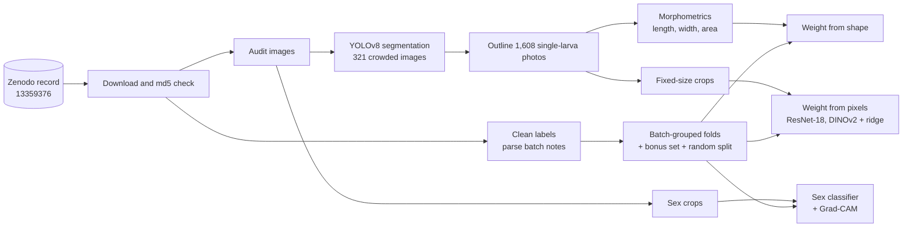
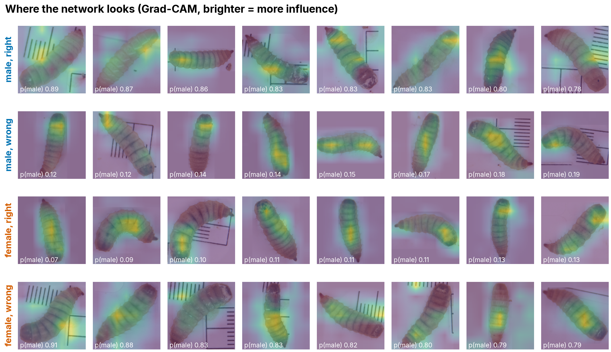

# LarvaLens

From photos to phenotypes: counting, measuring, weighing and sexing black soldier fly larvae with computer vision.

[](https://doi.org/10.5281/zenodo.13359376)
[](LICENSE)

[](https://github.com/raihan-patwary/larvalens/actions/workflows/ci.yml)

<picture>
  <source media="(prefers-color-scheme: dark)" srcset="figures/fig01_hero_dark.png">
  
</picture>

## What it does

LarvaLens rebuilds and stress-tests the image pipeline of [Nawoya et al. (2025)](https://doi.org/10.1016/j.atech.2025.100953) on their public dataset, with one rule throughout: **models are scored on rearing batches they never saw**.

- **Count**: YOLOv8 instance segmentation finds and outlines larvae in crowded photos.
- **Size**: each single-larva photo is outlined, skeletonised and measured in millimetres.
- **Weight**: from shape (linear, power-law and gradient-boosting models) and straight from the pixels (a fine-tuned ResNet-18, and ridge regression on frozen DINOv2 features).
- **Sex**: a class-weighted ResNet-18 on the dataset's sex crops, with Grad-CAM to show where it looks.

## Results beside the paper

| Task | Our model | Ours, unseen batches | Ours, random split | Paper (random split) |
| --- | --- | --- | --- | --- |
| Detect and outline (mask AP50) | YOLOv8m-seg | | 0.89 (photo-grouped split) | 0.93 |
| Weight from shape (R²) | Linear on area, length, width | 0.53 ± 0.17 | 0.58 | 0.80 |
| Weight from pixels (R²) | ResNet-18 and DINOv2 + ridge | pending | pending | 0.71 |
| Sex (balanced accuracy / accuracy) | ResNet-18, class weights | 0.56 / 0.61 | 0.56 / 0.60 | accuracy 0.74 on a balanced subset |

What the honest test changes:

1. **Detection is solid.** Our split keeps all augmented copies of a photo together, which the paper's split may not have done; most remaining "errors" are larvae the labellers skipped.
2. **Weight from shape is harder than reported.** Image length agrees with caliper length only at r = 0.73, because larvae stretch and contract between the caliper and the camera. Unseen batches cost a little more again.
3. **Sex is barely predictable from a single photo** (ROC-AUC 0.57). The paper's 74% came from a hand-balanced subset; on all usable crops and unseen batches the signal is weak.
4. **The data needed care.** The audit found that the detection set holds only 185 distinct photos, that its two class IDs both mean "larva", and that 36 sex-crop files are not images. All of this is in [DATA_CARD.md](DATA_CARD.md) and [results/data_checks.md](results/data_checks.md).

## Quickstart

```bash
git clone https://github.com/raihan-patwary/larvalens && cd larvalens
uv sync                                # Python 3.11, pinned packages
uv run python -m larvalens data        # download, verify (md5), clean, audit and split
uv run python -m larvalens figures     # rebuild every figure from results/
uv run pytest                          # tests run on synthetic data only
```

GPU steps run as Kaggle notebooks in `kernels/` (photo QC, detection, measuring, weight from pixels, sex). Their small outputs are saved in `results/`, so every figure can be rebuilt without retraining.

## Pipeline



## Figure gallery

<table>
<tr><td><br>Labelled and predicted larvae</td>
<td><br>Count agreement</td></tr>
<tr><td><br>How a larva is measured</td>
<td><br>Image against caliper length</td></tr>
<tr><td><br>Predicted against measured weight</td>
<td><br>Models against the paper</td></tr>
<tr><td><br>Sex classification</td>
<td><br>Where the network looks</td></tr>
<tr><td><br>Crops from lightest to heaviest</td>
<td><br>Weight against length</td></tr>
<tr><td><br>Data audit</td>
<td><br>Batch timeline</td></tr>
<tr><td><br>Weight by batch</td>
<td><br>Image quality</td></tr>
<tr><td><br>Detection training curves</td>
<td></td></tr>
</table>

Every figure is built by a script from saved results, with one style file (`src/larvalens/viz/bsf.mplstyle`) and colour-blind-safe colours with fixed meanings.

## Data and credit

Dataset: Geissmann, Q. (2024). *Black soldier fly larvae dataset*. Zenodo. https://doi.org/10.5281/zenodo.13359376 (CC BY 4.0). No data is stored in this repository; `python -m larvalens data` downloads it.

Paper: Nawoya, S., Geissmann, Q., Karstoft, H., Bjerge, K., Akol, R., Katumba, A., Mwikirize, C. and Gebreyesus, G. (2025). Prediction of black soldier fly larval sex and morphological traits using computer vision and deep learning. *Smart Agricultural Technology* 11, 100953. https://doi.org/10.1016/j.atech.2025.100953

All figures here are our own; none is reused from the paper. To cite this repository, see [CITATION.cff](CITATION.cff).

## Author

Md Raihan Patwary ([ORCID 0009-0006-0616-3742](https://orcid.org/0009-0006-0616-3742)). Licensed under AGPL-3.0, because Ultralytics YOLO is AGPL-3.0.

Built with [Claude Code](https://claude.com/claude-code).
