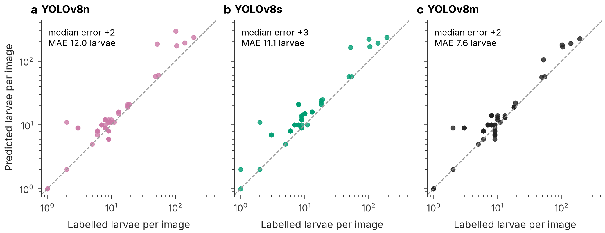
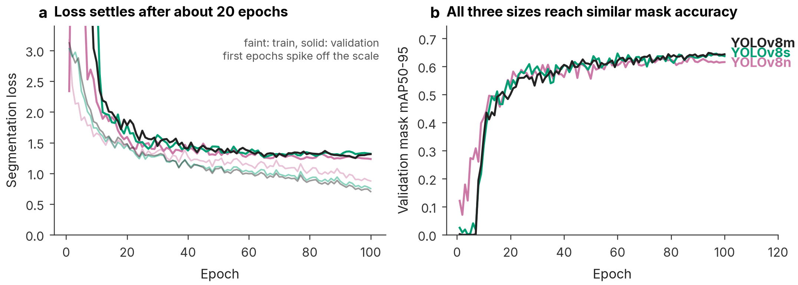
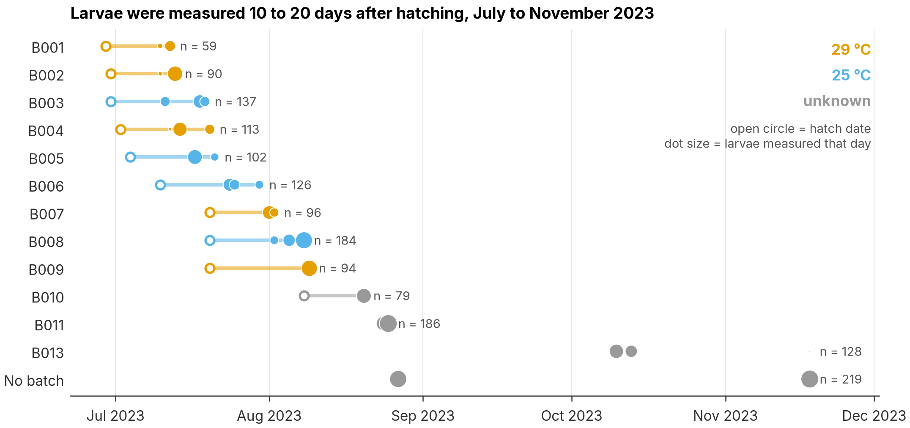
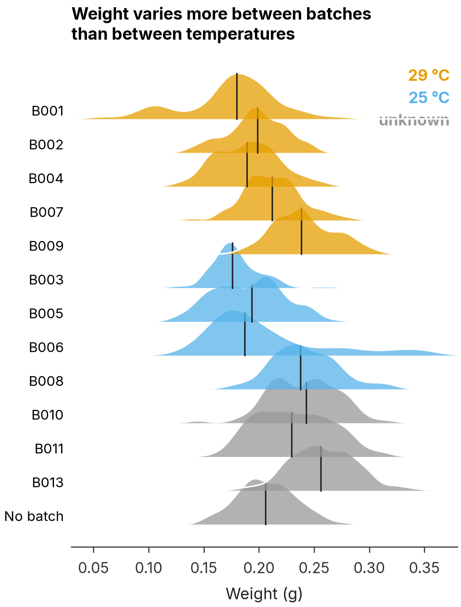

# LarvaLens

From photos to phenotypes: counting, measuring, weighing and sexing black soldier fly larvae with computer vision.

[](https://github.com/raihan-patwary/larvalens/actions/workflows/ci.yml)
[](https://doi.org/10.5281/zenodo.13359376)


Work in progress. This README grows block by block.

## Results so far

### Counting and outlining larvae

YOLOv8 instance segmentation on the 321 crowded images. The split keeps every augmented copy of a photo on the same side (train 130, validation 28, test 27 source photos), so test photos are truly unseen.

| Model | Mask AP50 | Mask AP50-95 | Box AP50 | Count error (median, larvae per image) |
| --- | --- | --- | --- | --- |
| YOLOv8n-seg | 0.87 | 0.63 | 0.87 | +2 |
| YOLOv8s-seg | 0.87 | 0.63 | 0.87 | +3 |
| YOLOv8m-seg | **0.89** | **0.66** | 0.88 | +2 |
| Nawoya et al. (2025), YOLOv8m-seg | 0.93 | | | |

Our numbers are a little below the paper's. Two things explain most of the gap. The paper's 224/97 split does not say how augmented copies were handled, so copies of a test photo may have been in training. And many larvae in the crowded photos were never labelled, so correct detections of them count as false positives and as over-counts.






### The data

All expected values in the planning brief were confirmed (`results/data_checks.md`). The audit also found problems worth knowing about, listed in [DATA_CARD.md](DATA_CARD.md).






## Quickstart

```bash
uv sync                      # Python 3.11 environment with pinned packages
uv run python -m larvalens data      # download, verify, clean, audit and split
uv run python -m larvalens figures   # rebuild every figure from saved results
uv run pytest
```

GPU steps run as Kaggle notebooks in `kernels/`.

## Data

Geissmann, Q. (2024). Black soldier fly larvae dataset. Zenodo. https://doi.org/10.5281/zenodo.13359376 (CC BY 4.0).

Nawoya, S., et al. (2025). Prediction of black soldier fly larval sex and morphological traits using computer vision and deep learning. Smart Agricultural Technology 11, 100953. https://doi.org/10.1016/j.atech.2025.100953
