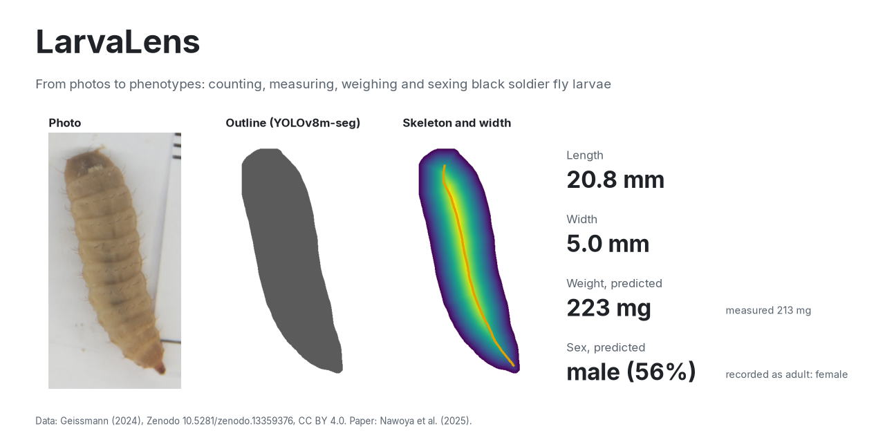
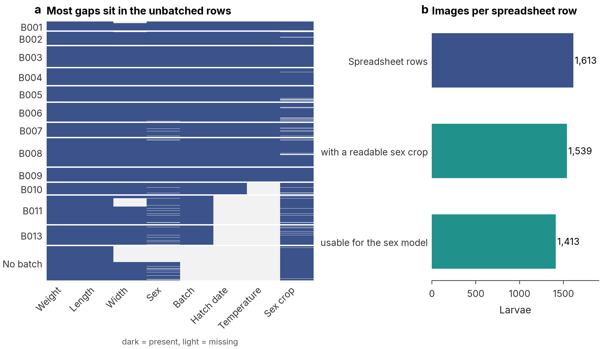
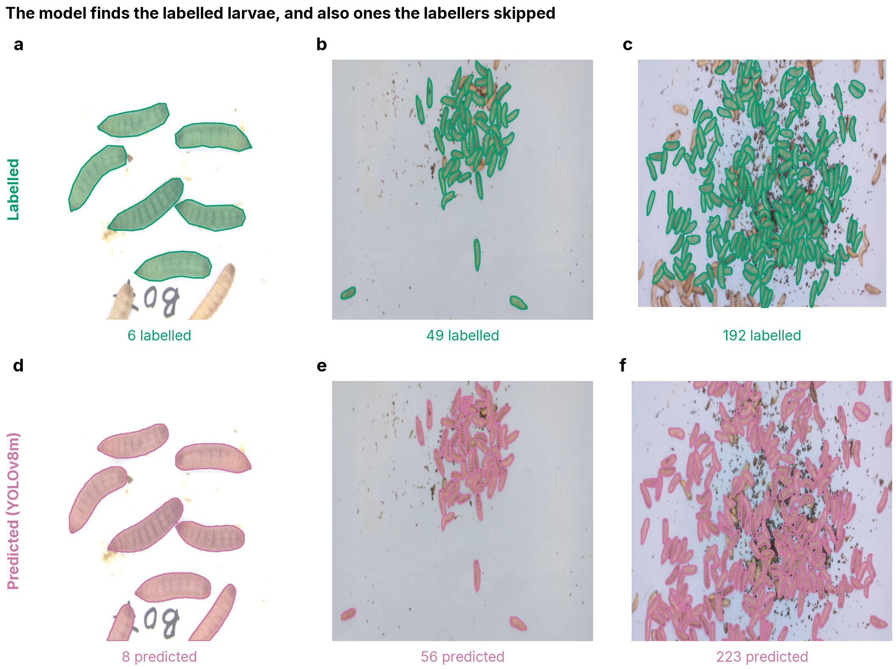
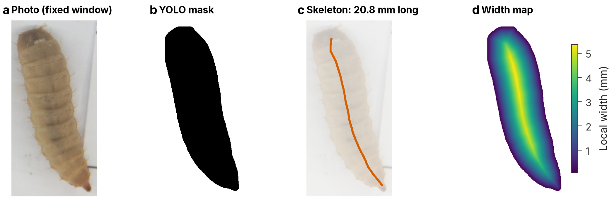
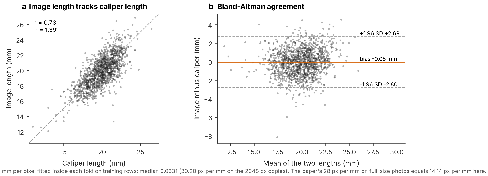
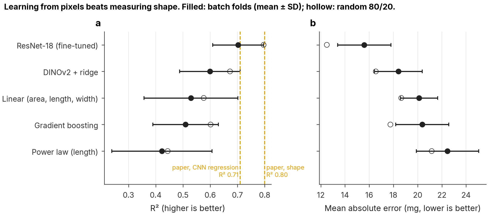
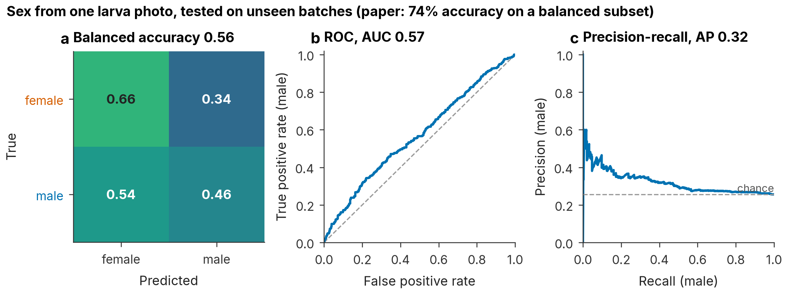
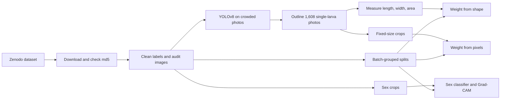

# LarvaLens

From photos to phenotypes: counting, measuring, weighing and sexing black soldier fly larvae with computer vision.

[](https://doi.org/10.5281/zenodo.13359376)
[](LICENSE)

[](https://github.com/raihan-patwary/larvalens/actions/workflows/ci.yml)

<picture>
  <source media="(prefers-color-scheme: dark)" srcset="figures/fig01_hero_dark.png">
  
</picture>

## Why this project

Black soldier fly larvae turn food waste into protein for animal feed, and insect farms need to know how big, how heavy and which sex their larvae are. Weighing and sexing them by hand is slow. A camera could do it, and in 2025 a team at Aarhus University showed how ([Nawoya et al., 2025](https://doi.org/10.1016/j.atech.2025.100953)), and released their photos and measurements as an open dataset.

I work on image-based live weight estimation in cattle, where the same steps apply: find the animal, outline it, measure it, and predict its weight. This dataset let me build that whole pipeline in the open, on a public benchmark, and ask one question the paper left open: **do the results hold for larvae from a rearing batch the model has never seen?** That is the situation a real farm would face.

## What I did differently

| | Nawoya et al. (2025) | LarvaLens |
| --- | --- | --- |
| How models are tested | Random 80/20 split of larvae | Whole rearing batches held out (5-fold, grouped by batch), plus the random split for comparison |
| Detection test set | 224 / 97 images | Split by source photo, because the 321 images contain augmented copies of only 185 photos |
| Weight from pixels | Crops resized to 224 px, size fed back in | One fixed window for every larva, so the network sees true size |
| Sex | Data cut down to a balanced subset | All usable crops, class weights, balanced accuracy |
| Code and models | Not published with the dataset | Everything here: download with checksums, tests, notebooks, figures rebuilt from saved results |

Before modelling, every number in the dataset was checked against the paper. The audit found real problems: two class IDs that both mean "larva", 36 sex-crop files that are not images, and two larva IDs with two different crops. All of it is listed in the [data card](DATA_CARD.md).

## Results

| Task | Our model | Unseen batches | Random split | Paper (random split) |
| --- | --- | --- | --- | --- |
| Find and outline larvae (mask AP50) | YOLOv8m-seg | | 0.89 (photo-grouped) | 0.93 |
| Weight from pixels (R²) | ResNet-18, fine-tuned | **0.70 ± 0.09** | **0.80** (error 12.5 mg) | 0.71 |
| Weight from shape (R²) | Linear on area, length, width | 0.53 ± 0.17 | 0.58 | 0.80 |
| Sex (balanced accuracy) | ResNet-18, class weights | 0.56 | 0.56 | 74% accuracy on a balanced subset |

What this means:

- **Weight is best learned straight from the photo.** On a random split the network matches the paper's best number, and it still reaches R² 0.70 on batches it never saw.
- **Measuring shape and converting it to weight works less well than reported.** Image length agrees with caliper length only at r = 0.73, because larvae stretch and contract between the caliper and the camera.
- **Sex is barely visible in a single photo** (ROC-AUC 0.57). The network finds no reliable cue once it is tested honestly.
- **Detection is solid.** Most remaining "errors" are larvae that the labellers skipped in crowded photos.

## Key figures

All 18 figures are in [`figures/`](figures/). These six tell the story.

**1. The data needed cleaning first.**
Most missing values sit in the 219 larvae with no recorded batch, and only 1,413 of the sex crops can be used.


**2. The detector finds larvae, including ones nobody labelled.**
Top row: the labels shipped with the dataset. Bottom row: our YOLOv8m model on test photos it never saw. Extra detections in crowded photos are mostly real larvae left unlabelled.


**3. Each larva is measured from its outline.**
The outline gives the area, its skeleton gives the length, and the distance to the edge gives the width. Pixels become millimetres with a scale fitted only on training larvae.


**4. Image length and caliper length agree only roughly.**
The two measurements differ by up to ±2.7 mm for the same larva. This limits every model that weighs larvae from their measured shape.


**5. Learning from pixels beats measuring shape.**
Filled dots are scores on unseen batches; hollow dots are the random split. Dashed lines are the paper's values.


**6. Sex is close to chance.**
The confusion matrix, ROC and precision-recall curves all sit near the chance line on unseen batches.


## Pipeline



## Reproduce the results

```bash
git clone https://github.com/raihan-patwary/larvalens
cd larvalens
uv sync                               # Python 3.11 with pinned packages
uv run python -m larvalens data       # download, verify, clean, audit and split
uv run python -m larvalens figures    # rebuild every figure from results/
uv run pytest                         # tests use synthetic data only
```

The GPU steps run as public Kaggle notebooks. The same code is in [`kernels/`](kernels/), and their small outputs are saved in [`results/`](results/), so every figure can be rebuilt without a GPU.

| Step | Kaggle notebook |
| --- | --- |
| 1. Download and check the 6.9 GB photo set | [larvalens-01-photos](https://www.kaggle.com/code/mdraihanpatwary02/larvalens-01-photos) |
| 2. Train YOLOv8 detection and segmentation | [larvalens-02-detect](https://www.kaggle.com/code/mdraihanpatwary02/larvalens-02-detect) |
| 3. Outline and measure every larva | [larvalens-03-measure](https://www.kaggle.com/code/mdraihanpatwary02/larvalens-03-measure) |
| 4. Weight from pixels (ResNet-18, DINOv2) | [larvalens-04-pixels-v2](https://www.kaggle.com/code/mdraihanpatwary02/larvalens-04-pixels-v2) |
| 5. Sex classification and Grad-CAM | [larvalens-05-sex](https://www.kaggle.com/code/mdraihanpatwary02/larvalens-05-sex) |

The notebooks read the package, splits and labels from the [larvalens-support](https://www.kaggle.com/datasets/mdraihanpatwary02/larvalens-support) dataset.

## Data and credit

Dataset: Geissmann, Q. (2024). *Black soldier fly larvae dataset*. Zenodo. https://doi.org/10.5281/zenodo.13359376 (CC BY 4.0). No data is stored in this repository; `python -m larvalens data` downloads it.

Paper: Nawoya, S., Geissmann, Q., Karstoft, H., Bjerge, K., Akol, R., Katumba, A., Mwikirize, C. and Gebreyesus, G. (2025). Prediction of black soldier fly larval sex and morphological traits using computer vision and deep learning. *Smart Agricultural Technology* 11, 100953. https://doi.org/10.1016/j.atech.2025.100953

All figures are my own; none is reused from the paper. To cite this repository, see [CITATION.cff](CITATION.cff).

## Author

Md Raihan Patwary. Licensed under AGPL-3.0, because Ultralytics YOLO is AGPL-3.0.

Built with [Claude Code](https://claude.com/claude-code).
